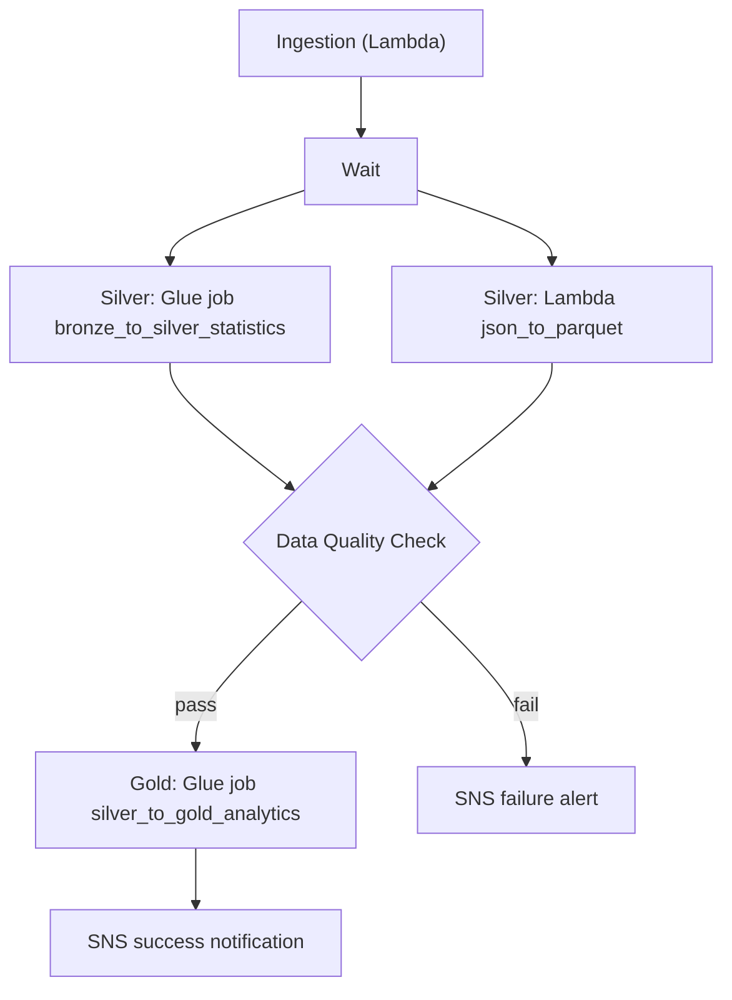

# 📺 YouTube Trending Data Pipeline

**A serverless, cloud-native ETL pipeline on AWS that ingests live YouTube trending data for 10 countries, refines it through a Bronze → Silver → Gold medallion architecture, blocks bad data with an automated quality gate, and serves analytics-ready tables through Athena.**


-0A66C2)


---

## ✨ Highlights

- **End-to-end data engineering workflow** — ingestion, transformation, validation, aggregation and querying, fully orchestrated.
- **Medallion architecture** (Bronze / Silver / Gold) on Amazon S3 with the Glue Data Catalog as the metadata layer.
- **Live API ingestion** from YouTube Data API v3 for 10 regions, combined with historical Kaggle data for backfill.
- **Data quality gate** — Silver data is validated (row count, nulls, schema, value ranges, freshness) before Gold runs; failures stop the pipeline and trigger an SNS alert.
- **Parallel Silver processing** — Glue (PySpark) and Lambda branches run side by side in Step Functions.
- **Resilient by design** — retries with exponential backoff, failure and success notifications.
- **Analytics-ready output** — three Gold tables, partitioned Parquet (Snappy), queryable in Athena and QuickSight.

---

## 📑 Table of Contents

- [Overview](#-overview)
- [Architecture](#-architecture)
- [Tech Stack](#-tech-stack)
- [Data Flow](#-data-flow)
- [Gold Layer Tables](#-gold-layer-tables)
- [Example Queries](#-example-queries)
- [Project Structure](#-project-structure)
- [Getting Started](#-getting-started)
- [Configuration](#-configuration)
- [Deployment](#-deployment)
- [Running the Pipeline](#-running-the-pipeline)
- [Monitoring and Alerting](#-monitoring-and-alerting)
- [Design Decisions](#-design-decisions)
- [Future Improvements](#-future-improvements)
- [Supported Regions](#-supported-regions)
- [Data Sources](#-data-sources)
- [Author](#-author)

---

## 📌 Overview

Most public YouTube trending datasets are static Kaggle downloads that go stale. This project replaces that manual process with an automated pipeline that pulls **live trending data** from the YouTube Data API v3 on a schedule, merges it with historical Kaggle data, and produces three business-level analytics tables:

| Output | What it answers |
|---|---|
| **Trending Analytics** | How many videos trend each day per region, and how engaged are viewers? |
| **Channel Analytics** | Which channels trend most often, and how do they rank within a region? |
| **Category Analytics** | Which content categories capture the largest share of views? |

The pipeline covers **10 regions** and runs on a configurable EventBridge schedule.

---

## 🏗 Architecture

The pipeline follows the **Medallion Architecture**:

| Layer | Purpose | Storage | Processed by |
|---|---|---|---|
| **Bronze** | Raw, immutable data as received | S3 (JSON from API, CSV from Kaggle) | Lambda (ingestion) |
| **Silver** | Cleansed, typed, deduplicated data | S3 (Parquet, partitioned by region) | Glue PySpark job + Lambda |
| **Quality Gate** | Validate Silver before it moves on | — | Lambda (`dq_lambda`) |
| **Gold** | Business aggregations | S3 (Parquet, partitioned by region) | Glue PySpark job |
| **Consumption** | Ad-hoc SQL and dashboards | Glue Data Catalog | Athena, QuickSight |

### Orchestration

AWS Step Functions coordinates the full run:



Cross-cutting services: **IAM** (roles and permissions), **SNS** (success/failure alerts) and **CloudWatch** (logging and monitoring).

---

## 🛠 Tech Stack

| Component | Technology |
|---|---|
| **Compute** | AWS Lambda, AWS Glue (PySpark) |
| **Storage** | Amazon S3 (Parquet, Snappy), S3 Glacier (lifecycle archive) |
| **Orchestration** | AWS Step Functions |
| **Scheduling** | Amazon EventBridge |
| **Metadata** | AWS Glue Data Catalog, Glue Crawler |
| **Query Engine** | Amazon Athena |
| **BI / Visualization** | Amazon QuickSight |
| **Alerting** | Amazon SNS |
| **Monitoring** | Amazon CloudWatch |
| **Security** | AWS IAM |
| **Languages** | Python 3, PySpark, SQL |
| **Libraries** | Pandas, AWS SDK for pandas (awswrangler), Boto3 |
| **Data Format** | Parquet (Snappy compression) |

---

## 🔄 Data Flow

### 1. Bronze Layer — raw data

The ingestion Lambda (`youtube_api_integstion`) calls the YouTube Data API v3 and collects:

- **Trending videos** — the top 50 trending videos per region
- **Category mappings** — category ID → name reference data

Raw JSON is stored in S3, partitioned by region, date and hour:

```
s3://<bronze-bucket>/youtube/raw_statistics/region=US/date=2026-04-01/hour=12/
s3://<bronze-bucket>/youtube/raw_statistics_reference_data/region=US/
```

Historical Kaggle CSVs can be loaded into Bronze with `scripts/aws_copy.sh`. A Glue Crawler catalogs the Bronze data, and a lifecycle rule archives older raw data to S3 Glacier.

### 2. Silver Layer — cleansed data

Two transformations run **in parallel**:

**a) Statistics — Glue job `bronze_to_silver_statistics`**
- Schema enforcement across both API JSON and Kaggle CSV formats
- Type casting (views, likes, dislikes → `Long`; dates parsed)
- Null handling and region standardization
- Deduplication (latest record per video / region / date)
- Derived metrics: `like_ratio`, `engagement_rate`
- Output: Parquet (Snappy), partitioned by region

> **Note:** YouTube no longer exposes dislike counts through the API, so `dislikes` is populated only for the historical Kaggle data.

**b) Reference data — Lambda `json_to_parquet`**
- Normalizes JSON category mappings into a tabular format
- Removes duplicate category entries
- Output: Parquet, partitioned by region

### 3. Data Quality Gate

Before anything reaches Gold, `dq_lambda` validates the Silver data:

| Check | Rule |
|---|---|
| Row count | ≥ 10 rows |
| Null percentage | ≤ 5% on critical columns |
| Schema validation | All required columns present |
| Value ranges | Views pass a sanity check |
| Data freshness | Latest data < 48 hours old |

If **any** check fails, the pipeline halts, Gold aggregation does **not** run, and an **SNS alert** with the failure details is sent.

### 4. Gold Layer — business aggregations

The Glue job `silver_to_gold_analytics` builds three tables from the validated Silver data (described below). All Gold tables are Parquet (Snappy), partitioned by `region` and registered in the Glue Data Catalog.

---

## 📊 Gold Layer Tables

### `trending_analytics`
Daily trending metrics per region.

| Column | Description |
|---|---|
| `region` | Country code (US, GB, IN, …) |
| `trending_date_parsed` | Date of the trending snapshot |
| `total_videos` | Number of trending videos |
| `total_views` | Sum of all views |
| `total_likes` | Sum of all likes |
| `avg_views_per_video` | Average views per trending video |
| `avg_like_ratio` | Average like-to-view ratio |
| `avg_engagement_rate` | Average engagement rate |
| `unique_channels` | Count of distinct channels |
| `unique_categories` | Count of distinct categories |

### `channel_analytics`
Channel-level performance and ranking.

| Column | Description |
|---|---|
| `channel_title` | YouTube channel name |
| `region` | Country code |
| `total_videos` | Videos that trended |
| `total_views` | Total views across trending videos |
| `avg_engagement_rate` | Average engagement rate |
| `times_trending` | Number of trending appearances |
| `rank_in_region` | Performance rank within the region |
| `categories` | Categories the channel appears in |

### `category_analytics`
Category-level breakdown with view share.

| Column | Description |
|---|---|
| `category` | Video category name |
| `region` | Country code |
| `trending_date_parsed` | Date of the trending snapshot |
| `video_count` | Number of videos in the category |
| `total_views` | Total views for the category |
| `avg_engagement_rate` | Average engagement rate |
| `view_share_pct` | Percentage of total views |

---

## 🔍 Example Queries

Run these in Athena against the Gold database (`yt-data-analysis-pipeline-gold-db-dev`).

**Top trending channels in the US**
```sql
SELECT channel_title, total_views, times_trending
FROM yt-data-analysis-pipeline-gold-db-dev.channel_analytics
WHERE region = 'US'
ORDER BY total_views DESC
LIMIT 10;
```

**Category share of views in India**
```sql
SELECT category,
       SUM(total_views)        AS views,
       ROUND(AVG(view_share_pct), 2) AS avg_view_share_pct
FROM yt-data-analysis-pipeline-gold-db-dev.category_analytics
WHERE region = 'IN'
GROUP BY category
ORDER BY views DESC
LIMIT 10;
```

**Daily trending volume and engagement by region**
```sql
SELECT region, trending_date_parsed, total_videos, avg_engagement_rate
FROM yt-data-analysis-pipeline-gold-db-dev.trending_analytics
ORDER BY trending_date_parsed DESC, region
LIMIT 50;
```

<!-- TODO: add 1–2 screenshots here (Athena query result, Step Functions successful execution, QuickSight dashboard) -->

---

## 📁 Project Structure

```
youtube-data-pipeline/
│
├── lambdas/
│   ├── youtube_api_integstion/        # Ingestion Lambda
│   │   └── lambda_function.py         # Fetches trending videos & categories from YouTube API
│   └── json_to_parquet/               # Reference data transformation Lambda
│       └── lambda_function.py         # Converts JSON category mappings to Parquet
│
├── glue_jobs/
│   ├── bronze_to_silver_statistics.py # PySpark: raw data → cleansed statistics
│   └── silver_to_gold_analytics.py    # PySpark: cleansed data → business aggregations
│
├── data_quality/
│   └── dq_lambda.py                   # Data quality validation Lambda
│
├── step_functions/
│   └── pipeline_orchestation.json     # Step Functions state machine definition
│
├── scripts/
│   ├── aws_copy.sh                    # Upload historical data to the Bronze S3 bucket
│   └── information.md                 # AWS resource names & configuration reference
│
├── data/                              # Reference & historical data
│   ├── {region}videos.csv             # Kaggle trending datasets (10 regions)
│   └── {region}_category_id.json      # YouTube category ID mappings (10 regions)
│
└── YouTube Trending Data Pipeline.png # Architecture diagram
```

---

## 🚀 Getting Started

### Prerequisites

- **AWS account** with permissions for Lambda, Glue, S3, Step Functions, SNS, IAM, Athena, EventBridge and CloudWatch
- **YouTube Data API v3 key** — create one in the [Google Cloud Console](https://console.cloud.google.com/apis/credentials)
- **AWS CLI** configured with credentials
- **Python 3.9+** for local development

### Clone the repository

```bash
git clone https://github.com/<your-github-username>/youtube-data-pipeline-2026.git
cd youtube-data-pipeline-2026
```

### Create the AWS infrastructure

Replace `<aws-region>` and `<env>` (for example `ap-south-1` and `dev`).

**S3 buckets**
```bash
aws s3 mb s3://yt-data-pipeline-bronze-<aws-region>-<env>
aws s3 mb s3://yt-data-pipeline-silver-<aws-region>-<env>
aws s3 mb s3://yt-data-pipeline-gold-<aws-region>-<env>
aws s3 mb s3://yt-data-pipeline-script-<aws-region>-<env>
```

**Glue databases**
```bash
aws glue create-database --database-input '{"Name": "yt_pipeline_bronze_<env>"}'
aws glue create-database --database-input '{"Name": "yt_pipeline_silver_<env>"}'
aws glue create-database --database-input '{"Name": "yt_pipeline_gold_<env>"}'
```

**SNS alert topic**
```bash
aws sns create-topic --name yt-data-pipeline-alerts-<env>
aws sns subscribe --topic-arn <topic-arn> --protocol email --notification-endpoint <your-email>
```

---

## ⚙️ Configuration

### Ingestion Lambda

| Variable | Description | Example |
|---|---|---|
| `YOUTUBE_API_KEY` | YouTube Data API v3 key | `AIzaSy...` |
| `S3_BUCKET_BRONZE` | Bronze S3 bucket name | `yt-analysis-pipeline-bronze-us-east-1-dev` |
| `YOUTUBE_REGIONS` | Comma-separated region codes | `US,GB,CA,DE,FR,IN,JP,KR,MX,RU` |

> ⚠️ Never commit your API key. Set it as a Lambda environment variable (or store it in AWS Secrets Manager).

### Data Quality Lambda

| Variable | Description | Default |
|---|---|---|
| `S3_BUCKET_SILVER` | Silver S3 bucket name | — |
| `GLUE_DB_SILVER` | Silver Glue database name | `yt-data-analysis-pipeline-silver-db-dev` |
| `SNS_ALERT_TOPIC_ARN` | SNS topic ARN for alerts | — |
| `DQ_MIN_ROW_COUNT` | Minimum row count threshold | `10` |
| `DQ_MAX_NULL_PERCENT` | Maximum null percentage allowed | `5.0` |

### Glue Jobs

Parameters are passed from the Step Functions state machine, or manually with `--arguments`:

| Parameter | Description |
|---|---|
| `--bronze_database` | Bronze Glue database name |
| `--bronze_table` | Bronze table name |
| `--silver_database` | Silver Glue database name |
| `--silver_bucket` | Silver S3 bucket name |
| `--gold_database` | Gold Glue database name |
| `--gold_bucket` | Gold S3 bucket name |

---

## 📦 Deployment

### 1. Upload Glue job scripts

```bash
aws s3 cp glue_jobs/bronze_to_silver_statistics.py s3://yt-data-pipeline-script-<aws-region>-<env>/glue_jobs/
aws s3 cp glue_jobs/silver_to_gold_analytics.py    s3://yt-data-pipeline-script-<aws-region>-<env>/glue_jobs/
```

### 2. Deploy the Lambda functions

```bash
# Ingestion Lambda
cd lambdas/youtube_api_integstion
zip -r function.zip lambda_function.py
aws lambda create-function \
  --function-name yt-data-pipeline-youtube-ingestion-<env> \
  --runtime python3.12 \
  --handler lambda_function.lambda_handler \
  --zip-file fileb://function.zip \
  --role <lambda-execution-role-arn> \
  --timeout 300 \
  --memory-size 256

# Repeat for json_to_parquet and the data quality Lambda
```

> Lambdas that use Pandas / `awswrangler` need the **AWS SDK for pandas** managed layer attached.

### 3. Create the Glue jobs

```bash
aws glue create-job \
  --name yt-data-analysis-pipeline-bronze-to-silver-<env> \
  --role <glue-role-arn> \
  --command '{"Name":"glueetl","ScriptLocation":"s3://yt-data-analysis-pipeline-script-<aws-region>-<env>/glue_jobs/bronze_to_silver_statistics.py"}' \
  --glue-version "4.0" \
  --number-of-workers 2 \
  --worker-type G.1X
```

Create the Silver → Gold job the same way, pointing at `silver_to_gold_analytics.py`.

### 4. Deploy the Step Functions state machine

```bash
aws stepfunctions create-state-machine \
  --name yt-data-analysis-pipeline \
  --definition file://step_functions/pipeline_orchestation.json \
  --role-arn <step-functions-role-arn>
```

### 5. (Optional) Backfill historical Kaggle data

```bash
cd data
bash ../scripts/aws_copy.sh
```

---

## ▶️ Running the Pipeline

### Scheduled (recommended)

```bash
aws events put-rule \
  --name yt-pipeline-schedule \
  --schedule-expression "rate(6 hours)"

aws events put-targets \
  --rule yt-pipeline-schedule \
  --targets '[{"Id":"1","Arn":"<state-machine-arn>","RoleArn":"<eventbridge-role-arn>"}]'
```

### Manual

```bash
aws stepfunctions start-execution --state-machine-arn <state-machine-arn>
```

### Execution order

| Step | Stage | What happens |
|---|---|---|
| 1 | **Ingestion** | Fetch data from the YouTube API → Bronze S3 |
| 2 | **Wait** | Short pause for S3 data consistency |
| 3 | **Silver transforms** | Run in parallel: Glue job `bronze_to_silver_statistics` and Lambda `json_to_parquet` |
| 4 | **Data quality** | Validate Silver data; blocks the pipeline on failure |
| 5 | **Gold aggregation** | Glue job `silver_to_gold_analytics` |
| 6 | **Notification** | SNS success or failure alert |

Each step retries up to 3 times with exponential backoff. Any unrecovered failure triggers an SNS notification with error details.

---

## 📡 Monitoring and Alerting

- **Step Functions console** — visual execution history and per-step status
- **CloudWatch Logs** — detailed logs from Lambda functions and Glue jobs
- **SNS** — email/SMS alerts on pipeline success or failure
- **Athena** — query the Gold tables directly to validate results

---

## 🧠 Design Decisions

| Decision | Why |
|---|---|
| **Medallion layers** | Keeps raw data immutable and replayable, and isolates cleaning from business logic. |
| **Quality gate before Gold** | Stops bad or stale data from reaching dashboards; failures are visible immediately via SNS. |
| **Parquet + Snappy, partitioned by region** | Columnar storage with partition pruning keeps Athena scans small and cheap. |
| **Glue for statistics, Lambda for reference data** | Large/variable statistics data suits distributed PySpark; small category files are cheaper and faster in Lambda. |
| **Unified schema for API JSON and Kaggle CSV** | Lets live and historical data flow through the same Silver and Gold logic. |
| **Deduplication on video / region / date** | Repeated scheduled runs can fetch the same video more than once; the latest record wins. |
| **Step Functions for orchestration** | Native retries, parallel branches and error handling with a visual audit trail. |

---

## 🔮 Future Improvements

- [ ] Infrastructure as Code (Terraform or AWS CDK) in place of CLI setup
- [ ] CI/CD with GitHub Actions for automated Lambda / Glue deployment
- [ ] Move the API key to AWS Secrets Manager
- [ ] Unit tests for transformations and DQ rules
- [ ] Richer data quality tooling (e.g. AWS Glue Data Quality or Great Expectations)
- [ ] Incremental processing with Glue job bookmarks
- [ ] Published QuickSight dashboard

---

## 🌍 Supported Regions

| Code | Country | Code | Country |
|---|---|---|---|
| US | United States | IN | India |
| GB | United Kingdom | JP | Japan |
| CA | Canada | KR | South Korea |
| DE | Germany | MX | Mexico |
| FR | France | RU | Russia |

---

## 📚 Data Sources

- **YouTube Data API v3** — live trending video data (primary source)
- **Kaggle YouTube Trending Dataset** — historical data for backfill and testing

---
